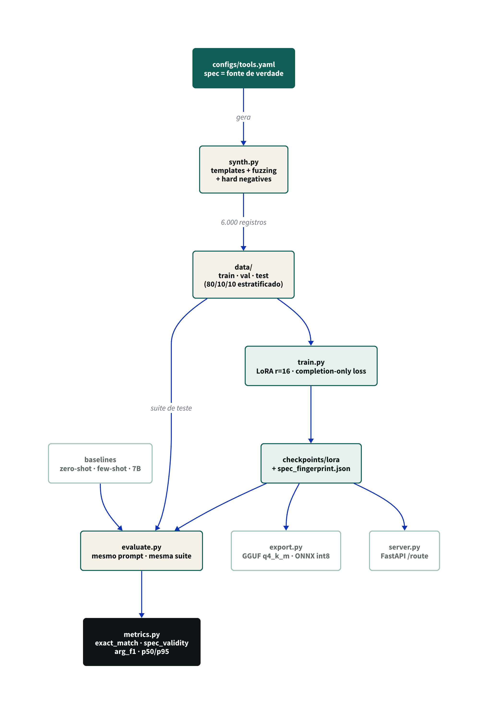

<div align="center">

# nanorouter

**Fine-tuning de um SLM de 0,5B para emitir JSON de roteamento válido contra um schema — com dataset sintético, harness de avaliação e baselines rodando no mesmo prompt.**

[](https://github.com/yahbeaumont/nanorouter/actions/workflows/ci.yml)
[](LICENSE)
[](pyproject.toml)
[](https://huggingface.co/Qwen/Qwen2.5-0.5B-Instruct)

</div>

---

## Estado deste repositório

O harness está completo e verificado de ponta a ponta: spec de ferramentas, geração de dataset, validação de contrato, métricas, baselines, CLI, API, export e CI. **A run de treino e avaliação ainda não foi executada neste repositório**, então não há tabela de resultados publicada aqui — `docs/RESULTS.md` é gerado por `make eval`, na sua máquina, e não copiado de outro lugar.

O que já foi medido, rodando `make data`, `make test` e `make lint` no commit inicial:

| verificação | comando | resultado |
|---|---|---|
| dataset | `make data` | 6.000 registros, 100% válidos contra o spec, 4.556 enunciados distintos |
| distribuição | `make data` | 70,1% tool · 18,0% hard negative · 11,9% `no_tool` |
| testes | `make test` | 35 testes, 85% de cobertura |
| lint e tipos | `make lint` | ruff e mypy sem apontamentos |

A próxima etapa é a que dá sentido ao resto: `make train` seguido de `make eval` para popular a tabela de comparação com número próprio.

## A tese

Roteamento é uma tarefa estreita: escolher uma ferramenta entre oito e preencher slots tipados. Para esse perfil, um modelo pequeno ajustado ao contrato deveria competir com um modelo muito maior que nunca foi ensinado a respeitar schema. A hipótese deste projeto é que **aderência ao contrato pesa mais que capacidade bruta** em tarefas de saída fechada.

O repositório existe para testar essa hipótese de forma reprodutível: mesmo prompt, mesma suite, mesmos baselines, métrica objetiva. Sem número medido, a hipótese continua hipótese — e é assim que está declarado aqui.

## O problema

Todo agente com ferramentas precisa decidir **qual** ferramenta chamar **antes** de chamar um LLM caro. Na prática, modelos base falham nesse passo por motivo banal: emitem JSON com campo inventado, vírgula sobrando, texto em volta, `null` onde o slot era obrigatório. O alvo do fine-tuning não é "um modelo mais inteligente", é **um modelo que obedece um contrato**.

## Como funciona



1. **Spec como fonte de verdade** — `configs/tools.yaml` define ferramentas, slots, tipos e obrigatoriedade. Prompt, dataset e validação derivam todos dele, e o hash do spec (`spec_fingerprint`) é gravado junto ao checkpoint para amarrar modelo e contrato.
2. **Dataset sintético com hard negatives** — 70% tool, 12% `no_tool` e 18% de enunciados que citam a superfície lexical de uma ferramenta vizinha mas pertencem a outra. Os hard negatives são templates parametrizados, não frases fixas: com dez frases fixas o dataset viraria dez exemplos repetidos cem vezes e a métrica passaria a medir memorização.
3. **LoRA com completion-only loss** — a loss incide só no JSON alvo; sem isso, a maior parte dos tokens supervisionados é prompt de sistema fixo e o adapter aprende o catálogo de cor.
4. **Eval contra baselines** — zero-shot, few-shot e modelo maior, todos no mesmo harness e na mesma suite.
5. **Export** — GGUF `q4_k_m` e ONNX int8, com paridade de prompt entre treino e produção.

## Quickstart

```bash
git clone https://github.com/yahbeaumont/nanorouter && cd nanorouter
python -m venv .venv && source .venv/bin/activate
make setup

make data N=6000          # ~15 s
make train                # ~20 min em GPU, ~2 h em CPU
make eval                 # grava outputs/eval/RESULTS.md + matrizes de confusão
make export
```

Sem treinar, dá para inspecionar o dataset e o contrato:

```bash
make data
head -1 data/test.jsonl | python -m json.tool
python -m nanorouter.cli eval --limit 20   # exige o extra [train]
```

API local (sobe com o modelo base se não houver adapter):

```bash
NANOROUTER_ADAPTER=checkpoints/lora/final make serve
curl -s localhost:8000/route -H 'content-type: application/json' \
  -d '{"utterance": "cancela a reserva BK1042"}'
```

```json
{
  "utterance": "cancela a reserva BK1042",
  "decision": {"tool": "cancel_booking", "args": {"booking_id": "BK1042"}, "confidence": 0.94},
  "ok": true,
  "violations": [],
  "latency_ms": 36.2
}
```

## Métricas

| métrica | o que mede | por que existe |
|---|---|---|
| `exact_match` | JSON idêntico ao ouro | métrica principal |
| `tool_accuracy` | ferramenta correta | isola erro de seleção |
| `spec_validity` | passa na validação de spec | aderência ao contrato |
| `parse_error_rate` | saída sem JSON | falha catastrófica em produção |
| `arg_f1` | acerto de slots (micro) | qualidade de extração |
| `latency_p50/p95` | ms por chamada | viabilidade |

`confidence` tem tolerância de 0,25 no `exact_match`: é calibração, não verdade. O intervalo de confiança vem de bootstrap sobre os acertos, não de uma fórmula fechada.

## Estrutura

```
configs/     spec de ferramentas + hiperparâmetros
src/         schema, synth, train, eval, export, cli, server
tests/       schema, determinismo, métricas, pipeline, smoke
docs/        método, resultados, limitações
```

## Limitações

O dataset é sintético e herda o viés dos templates; oito ferramentas cabem no contexto, duzentas não; `confidence` não é probabilidade calibrada; enunciados com duas intenções legítimas retornam uma ferramenta só. O detalhamento está em [docs/LIMITATIONS.md](docs/LIMITATIONS.md).

## Licença

MIT. O modelo base é Apache-2.0.

## Citação

```bibtex
@misc{nanorouter2026,
  title  = {nanorouter: schema-valid routing JSON from a fine-tuned 0.5B SLM},
  author = {Hay Beaumont},
  year   = {2026},
  url    = {https://github.com/yahbeaumont/nanorouter}
}
```
