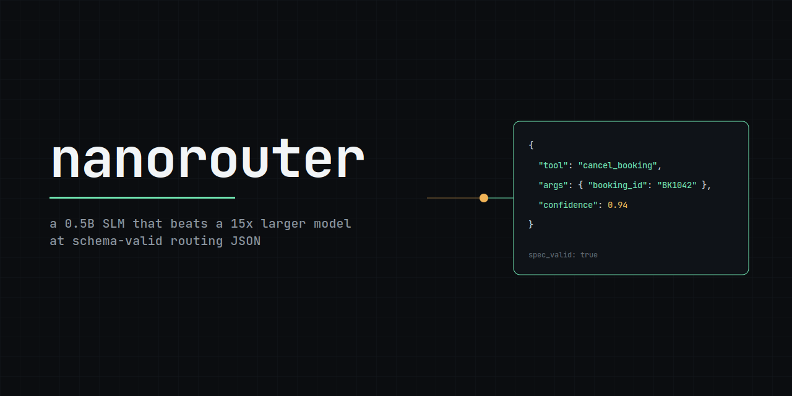

<div align="center">

# nanorouter

**Fine-tuning de um SLM de 0,5B para emitir JSON de roteamento válido contra um schema — com dataset sintético, harness de avaliação e baselines rodando no mesmo prompt.**

[](https://github.com/yahbeaumont/nanorouter/actions/workflows/ci.yml)
[](LICENSE)
[](pyproject.toml)
[](https://huggingface.co/Qwen/Qwen2.5-0.5B-Instruct)



</div>

---

## Resultados medidos

Tudo abaixo rodou neste repositório, no mesmo prompt e na mesma suite: 150 itens de
`data/test.jsonl`, 6 vCPU e nenhuma GPU. Método, custo e limitações em
[docs/RESULTS.md](docs/RESULTS.md).

| backend | exact_match | tool_acc | spec_valid | arg_f1 | p95 |
|---|---|---|---|---|---|
| Qwen2.5-0.5B zero-shot | 0,113 | 0,293 | 0,287 | 0,659 | 12,5 s |
| Qwen2.5-0.5B few-shot (4) | 0,273 | 0,700 | 0,420 | 0,585 | 6,4 s |
| Qwen2.5-7B q4_k_m zero-shot | 0,227 | 0,833 | 0,687 | 0,697 | 9,5 s |
| **Qwen2.5-0.5B + LoRA** | **0,587** | **0,973** | **0,807** | **0,744** | **6,4 s** |

O adapter viu 400 registros em uma época, 4.639 s de CPU. Mesmo assim, o modelo 15x maior perde em
todas as métricas, inclusive na aderência ao contrato que o banner do topo afirma: 0,807 contra
0,687. O número é medido aqui, não estimado.

Propriedades do gerador e da suíte, verificadas por `make data`, `make test` e `make lint`:

| verificação | resultado |
|---|---|
| dataset | 6.000 registros, 100% válidos contra o spec, 4.556 enunciados distintos |
| distribuição | 70,1% tool · 18,0% hard negative · 11,9% `no_tool` |
| testes | 47 testes, 84% de cobertura |
| lint e tipos | ruff e mypy sem apontamentos |

## A tese

Roteamento é uma tarefa estreita: escolher uma ferramenta entre oito e preencher slots tipados. Para esse perfil, um modelo pequeno ajustado ao contrato deveria competir com um modelo muito maior que nunca foi ensinado a respeitar schema. A hipótese era que **aderência ao contrato pesa mais que capacidade bruta** em tarefas de saída fechada.

A medição sustenta a hipótese. O 0,5B com LoRA chega a 0,807 de aderência ao spec contra 0,687 do 7B, e ganha também em decisão exata: 0,587 contra 0,227. O repositório existe para que essa comparação seja reprodutível por qualquer pessoa: mesmo prompt, mesma suite, mesmos baselines, métrica objetiva, comando publicado.

## O problema

Todo agente com ferramentas precisa decidir **qual** ferramenta chamar **antes** de chamar um LLM caro. Na prática, modelos base falham nesse passo por motivo banal: emitem JSON com campo inventado, vírgula sobrando, texto em volta, `null` onde o slot era obrigatório. O alvo do fine-tuning não é "um modelo mais inteligente", é **um modelo que obedece um contrato**.

## Como funciona


1. **Spec como fonte de verdade** — `configs/tools.yaml` define ferramentas, slots, tipos e obrigatoriedade. Prompt, dataset e validação derivam todos dele, e o hash do spec (`spec_fingerprint`) é gravado junto ao checkpoint para amarrar modelo e contrato.
2. **Dataset sintético com hard negatives** — 70% tool, 12% `no_tool` e 18% de enunciados que citam a superfície lexical de uma ferramenta vizinha mas pertencem a outra. Os hard negatives são templates parametrizados, não frases fixas: com dez frases fixas o dataset viraria dez exemplos repetidos cem vezes e a métrica passaria a medir memorização.
3. **LoRA com completion-only loss** — a loss incide só no JSON alvo; sem isso, a maior parte dos tokens supervisionados é prompt de sistema fixo e o adapter aprende o catálogo de cor.
4. **Eval contra baselines** — zero-shot, few-shot e modelo maior, todos no mesmo harness e na mesma suite.
5. **Export** — GGUF `q4_k_m` e ONNX int8, com paridade de prompt entre treino e produção.

## Quickstart

```bash
git clone https://github.com/yahbeaumont/nanorouter && cd nanorouter
python -m venv .venv && source .venv/bin/activate
make setup

make data N=6000          # ~15 s
make train                # ~20 min em GPU, ~2 h em CPU
make eval                 # grava outputs/eval/RESULTS.md + matrizes de confusão
make export
```

Para usar o adapter que gerou a tabela acima, sem treinar nada:

```bash
make fetch-adapter        # baixa o adapter de referência (release v0.1.0)
nanorouter route "cancela a reserva BK1042" --adapter checkpoints/lora/final
```

Sem treinar, dá para inspecionar o dataset e o contrato:

```bash
make data
head -1 data/test.jsonl | python -m json.tool
python -m nanorouter.cli eval --limit 20   # exige o extra [train]
```

Com um adapter treinado, o roteamento roda pelo CLI ou pelo Hub:

```bash
nanorouter route "cancela a reserva BK1042" --adapter checkpoints/lora/final
nanorouter route "cancela a reserva BK1042" --adapter yahbeaumont/nanorouter-lora
```

O adapter de referência é o da release `v0.1.0`, treinado com seed 1337 em 400 registros: `make fetch-adapter` baixa e extrai em `checkpoints/lora/final`. Para publicar um adapter seu no Hub, use `make publish`.

API local (sobe com o modelo base se não houver adapter):

```bash
NANOROUTER_ADAPTER=checkpoints/lora/final make serve
curl -s localhost:8000/route -H 'content-type: application/json' \
  -d '{"utterance": "cancela a reserva BK1042"}'
```

```json
{
  "utterance": "cancela a reserva BK1042",
  "backend": "hf:Qwen/Qwen2.5-0.5B-Instruct+checkpoints/lora/final",
  "latency_ms": 4300.6,
  "decision": {"tool": "cancel_booking", "args": {"booking_id": "BK1042"}, "confidence": 0.89},
  "ok": true,
  "violations": []
}
```

Saída real do adapter de referência em CPU, com o campo `raw` omitido por espaço. A latência é a
medida nesta máquina, não um alvo de projeto.

Em container: `make fetch-adapter && docker compose up --build`. O compose monta `./checkpoints` como volume e o servidor sobe com o adapter; sem o volume, ele sobe no modelo base e o `/health` informa qual backend está ativo.

## Métricas

| métrica | o que mede | por que existe |
|---|---|---|
| `exact_match` | JSON idêntico ao ouro | métrica principal |
| `tool_accuracy` | ferramenta correta | isola erro de seleção |
| `spec_validity` | passa na validação de spec | aderência ao contrato |
| `parse_error_rate` | saída sem JSON | falha catastrófica em produção |
| `arg_f1` | acerto de slots (micro) | qualidade de extração |
| `latency_p50/p95` | ms por chamada | viabilidade |

`confidence` tem tolerância de 0,25 no `exact_match`: é calibração, não verdade. O intervalo de confiança vem de bootstrap sobre os acertos, não de uma fórmula fechada.

## Estrutura

```
configs/     spec de ferramentas + hiperparâmetros
src/         schema, synth, train, eval, export, cli, server
scripts/     publicação do adapter no Hub
tests/       schema, determinismo, métricas, pipeline, smoke
docs/        método, resultados, limitações
```

## Publicando o adapter

O adapter treinado pode ir para o Hugging Face Hub com a model card já preenchida:

```bash
make publish-dry HF_REPO=<seu-usuario>/nanorouter-lora   # monta outputs/_publish, não envia
make publish     HF_REPO=<seu-usuario>/nanorouter-lora   # envia
```

A card em `docs/adapter_card.md` recebe o modelo base, o repo, a data e a tabela de `outputs/eval/RESULTS.md`. Sem essa run, a tabela sai como `sem run`: a card não herda número de outro lugar. Os pesos (`*.safetensors`) ficam fora do git; `adapter_config.json` e `spec_fingerprint.json` ficam versionados, porque são o que amarra o adapter ao contrato e à run que o gerou.

## Limitações

O dataset é sintético e herda o viés dos templates; oito ferramentas cabem no contexto, duzentas não; `confidence` não é probabilidade calibrada; enunciados com duas intenções legítimas retornam uma ferramenta só. O detalhamento está em [docs/LIMITATIONS.md](docs/LIMITATIONS.md).

## Licença

MIT. O modelo base é Apache-2.0.

## Citação

```bibtex
@misc{nanorouter2026,
  title  = {nanorouter: schema-valid routing JSON from a fine-tuned 0.5B SLM},
  author = {Hay Beaumont},
  year   = {2026},
  url    = {https://github.com/yahbeaumont/nanorouter}
}
```
